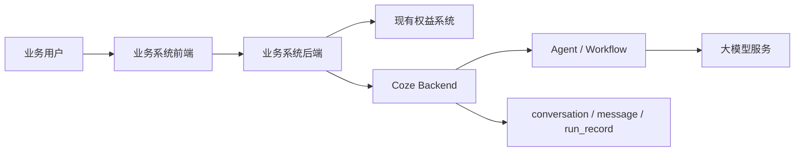
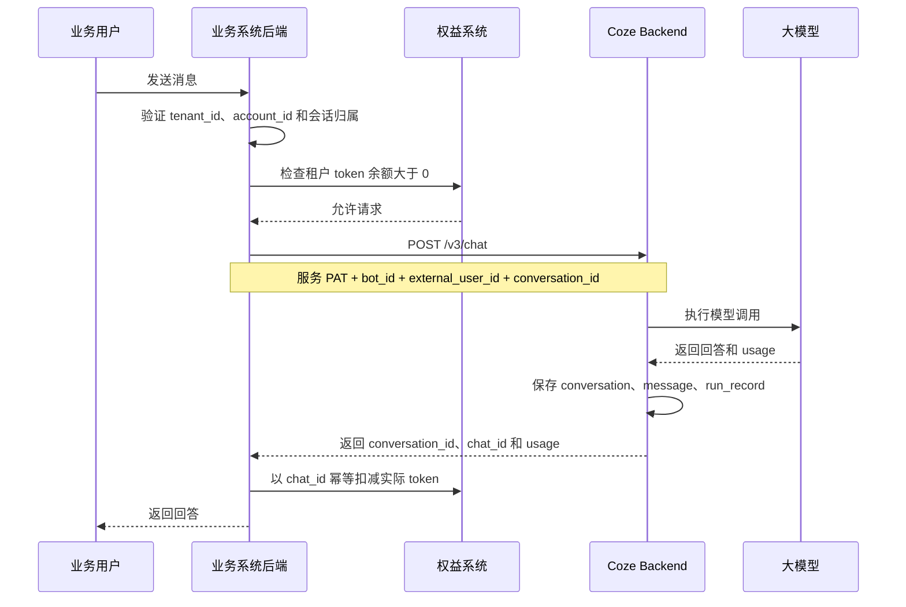

# 业务系统集成 Coze 的账号、对话与计费设计记录

> 状态：设计基线，尚未实施
> 记录日期：2026-08-20
> 目的：记录当前已经达成的结论，供后续在其他环境继续设计和实现。

## 1. 背景与已有条件

目标是在现有业务系统中嵌入 Coze 智能体的对话能力，并在后续为 Coze Studio 开源版增加类似 Dify 的 MCP 集成能力。

业务系统已经具备：

- 租户系统，拥有稳定的 `tenant_id`。
- 账号和登录系统，拥有稳定的 `account_id`。
- 租户级权益等级和权益消费能力。
- 将为智能体对话新增一种以 token 为单位的权益类型。

当前阶段不准备使用 Coze 账号作为业务用户账号，也不准备让业务用户直接进入 Coze Studio。

## 2. 核心结论

系统职责划分如下：

- 业务系统是用户、租户、登录态、授权、权益余额和消费流水的事实来源。
- Coze 是内部 Agent 执行引擎，负责 Agent 编排、模型调用、对话持久化和 usage 采集。
- 所有业务租户暂时共享一个 Coze 技术服务账号及其 Personal Access Token（PAT）。
- 业务用户不会创建对应的 Coze 账号。
- 对话按业务账号隔离，权益按业务租户扣减。
- 每调用一次 `/v3/chat` 完成一轮交互，并按该轮的 `chat_id` 和实际 usage 结算。
- 第一版不做 token 预扣，接受有限的单轮或并发透支风险。
- Coze Chat SDK 的界面可以复用，但其默认 PAT 鉴权方式不适合直接用于当前多租户场景。

## 3. 总体架构



关键安全边界：

- 浏览器只信任业务系统登录态。
- 浏览器不持有 Coze PAT。
- 业务后端从可信登录态中取得 `tenant_id` 和 `account_id`。
- 只有业务后端携带 Coze PAT 调用 Coze OpenAPI。

## 4. Coze 账号设计

### 4.1 当前采用的方式

创建一个 Coze 技术服务账号，由它：

1. 创建和发布 Agent、Workflow 等资源。
2. 创建一枚供业务后端使用的 PAT。
3. 作为所有业务租户调用 Coze 时的统一 Coze 身份。

当前 OpenAPI 会校验 PAT 所属 Coze 用户是否为 Agent 创建者，因此共享 Agent 时使用统一服务账号最简单。源码参考：

- [`OpenapiAgentRun` 的 Agent 创建者校验](../backend/application/conversation/openapi_agent_run.go#L51)

### 4.2 为什么不为每个租户创建 Coze 账号

业务权益属于哪个租户，与 Coze 需要多少账号没有直接关系。业务租户和账号已经由业务系统管理，没有必要在 Coze 中重复创建。

当前 Coze Studio 开源版虽然存在 User、Space 和 `space_user` 数据结构，但个人 Space 是主要可用形态，团队空间、成员管理和租户级权限体系不足以直接替代现有业务租户系统。

只有出现以下需求时，才重新考虑租户级 Coze 账号或一等租户模型：

- 租户管理员需要登录 Coze Studio。
- 租户需要自己创建和管理 Agent、知识库、Workflow 或 MCP 配置。
- 租户要求独立 PAT、独立资源权限和独立审计。
- 租户要求比业务后端代理更强的物理或逻辑隔离。

## 5. 身份与数据标识

| 概念 | 标识 | 归属系统 | 用途 |
| --- | --- | --- | --- |
| 业务租户 | `tenant_id` | 业务系统 | 权益归属和扣费 |
| 业务账号 | `account_id` | 业务系统 | 登录和最终用户身份 |
| Coze 外部用户 | `external_user_id` | 业务后端生成 | 对话和历史记录隔离 |
| Coze 用户 | `creator_id` | Coze | 服务账号及 Agent 所有者 |
| 多轮对话 | `conversation_id` | Coze | 一段连续上下文 |
| 单轮执行 | `chat_id` | Coze | 一次 `/v3/chat` 执行和计费幂等键 |

建议使用 `tenant_id + account_id` 生成稳定的 `external_user_id`，例如：

```text
tenant_100:account_200
```

如果标识包含敏感信息，可以改为稳定的不可逆派生值。无论采用哪种格式，业务后端都不能信任浏览器直接提交的 `tenant_id`、`account_id` 或 `external_user_id`。

## 6. Coze 对话数据模型

Coze 不是无状态的大模型代理。它会持久化对话执行数据：

```text
conversation：一段多轮对话
  └── run_record / chat_id：一次 /v3/chat 执行
        ├── 用户问题 message
        ├── Agent、工具或 Workflow 执行
        └── AI 回答 message
```

主要数据包括：

- `conversation`：Agent、`creator_id`、外部 `user_id`、名称、状态和时间等。
- `message`：`conversation_id`、`run_id`、外部 `user_id`、角色、内容和状态等。
- `run_record`：一次 Agent 运行的状态、外部 `user_id`、`conversation_id` 和 usage 等。

源码参考：

- [`conversation` 数据模型](../backend/domain/conversation/conversation/internal/dal/model/conversation.gen.go#L26)
- [`message` 数据模型](../backend/domain/conversation/message/internal/dal/model/message.gen.go#L10)
- [`run_record` 数据模型](../backend/domain/conversation/agentrun/internal/dal/model/run_record.gen.go#L13)

第一次调用 `/v3/chat` 且不传 `conversation_id` 时，Coze 会创建新会话，并把请求中的 `user` 写入会话的外部 `user_id`。后续调用复用同一个 `conversation_id`，消息会追加到同一段上下文。源码参考：

- [`checkConversation`](../backend/application/conversation/openapi_agent_run.go#L94)

请求在鉴权或参数校验阶段即失败时不会产生正常会话。执行中途失败时，可能保留失败的运行记录或未完成状态消息。

## 7. 历史对话方案

业务系统可以直接使用 Coze 作为历史对话的存储源，不必重复保存完整消息内容。

历史列表流程：

1. 业务后端从登录态计算当前账号的 `external_user_id`。
2. 调用 `GET /v1/conversations`，按 `bot_id + user_id` 查询会话列表。
3. 用户选择某个会话后，调用 `/v1/conversation/message/list` 查询消息。
4. 继续对话时，将对应的 `conversation_id` 传给 `/v3/chat`。

会话列表查询确实支持按外部 `user_id` 过滤：

- [`ListConversation`](../backend/application/conversation/conversation.go#L180)
- [`ConversationDAO.List`](../backend/domain/conversation/conversation/internal/dal/dao.go#L144)

### 7.1 已发现的隔离缺口

当前读取消息、继续对话、查询运行结果、改名和删除会话时，主要校验 `conversation.creator_id` 是否等于 PAT 所属 Coze 用户，没有全面校验 `conversation.user_id` 是否等于当前业务用户。

当所有租户共享同一个 Coze 服务账号时，它们的 `creator_id` 相同。因此，仅依赖当前 Coze 权限校验不足以形成最终用户级安全边界。

第一版至少需要：

- 所有 Coze 请求都经过业务后端。
- 业务后端验证 `conversation_id` 属于当前登录业务账号。
- 浏览器不能自由指定其他用户的 `external_user_id`。
- PAT 不能发送给浏览器。

生产环境推荐修改 Coze，在读取、继续、查询、改名和删除会话时，同时校验外部 `user_id`。源码参考：

- [`GetApiMessageList` 当前只校验 CreatorID](../backend/application/conversation/openapi_message.go#L44)
- [`checkConversation` 当前只校验 CreatorID](../backend/application/conversation/openapi_agent_run.go#L94)

## 8. Token usage 的来源与含义

原始 token 数通常来自大模型提供商返回的 usage。Coze 负责将其转换为统一结构，并关联到 Agent、会话、外部用户和运行记录。

当前主要字段为：

- 输入 token。
- 输出 token。
- 总 token。

Coze 的通用处理逻辑从模型响应的 `ResponseMeta.Usage` 中读取这些字段；如果模型适配器没有返回 usage，该层没有看到自行分词估算的兜底逻辑。源码参考：

- [`handlerUsage`](../backend/domain/conversation/agentrun/internal/message_builder.go#L180)

Workflow 存在 token 收集器，用于累加多个节点或模型调用的 usage：

- [`TokenCollector`](../backend/domain/workflow/internal/execute/collect_token.go#L40)

在正式以 usage 计费前，仍需对实际使用的 Agent、工具循环和 Workflow 做集成测试，确认一次 `chat_id` 返回的 usage 覆盖希望计费的全部模型调用。

本轮输入 token 不只包含当前用户消息，还可能包含：

- 系统提示词和 Agent 指令。
- 被带入模型的历史对话。
- 工具定义。
- RAG 检索结果。
- 工具循环中的模型调用。

MCP 服务、embedding、rerank、图片生成等非 LLM 资源消耗，不应默认认为已经包含在 LLM token usage 中。

## 9. 已确定的计费方案

### 9.1 计费粒度

每调用一次 `/v3/chat` 代表一轮用户交互，并产生一个 `chat_id`。计费粒度确定为：

```text
一条 chat_id = 一条权益消费流水 = 一次实际 token 结算
```

`conversation_id` 可以包含很多轮 `chat_id`，不能等整个会话结束后再统一扣费，因为用户可能永远不会显式结束会话。

### 9.2 第一版采用后结算

第一版不设计预扣，接受有限透支，流程如下：



具体规则：

1. 每轮调用前，只检查租户剩余 token 是否大于 0。
2. 每轮完成后，按该轮实际总 token 扣减租户权益。
3. 使用 `chat_id` 作为幂等键，同一轮只能成功扣费一次。
4. 扣减后余额小于等于 0，立即禁止该租户发起新请求。
5. 本轮实际消耗可以使余额短暂变为负数，不能只扣到零，否则会丢失真实账务。
6. 没有收到完成事件时，使用 `conversation_id + chat_id` 查询 Coze 运行状态和 usage 后补结算。
7. 执行失败但存在 usage 时按实际 usage 结算；没有 usage 时不扣 LLM token。

### 9.3 权益流水字段

优先复用现有权益消费记录。为了支持幂等、审计和对账，记录至少应能承载：

```text
tenant_id
account_id
entitlement_type
conversation_id
chat_id
input_tokens
output_tokens
total_tokens
settlement_status
created_at
```

业务系统的权益余额和消费流水是最终账务事实来源。Coze 的 `run_record` 是 usage 来源和对账依据，不直接承担业务余额管理。

### 9.4 不预扣时的风险控制

主要风险来自同一租户下多个账号并发请求，而不是普通单轮提问。

第一版至少应限制：

- 单租户最大并发运行数。
- 模型最大输出 token。
- Agent 最大工具循环次数。
- Workflow 最大循环次数。
- 最大上下文长度。

风险上界可以近似理解为：

```text
最大透支量约等于单租户最大并发数乘以单次运行最大 token
```

如果未来要求严格预付费、余额归零立即中止，则需要增加预扣和退款语义，或者修改 Coze 运行时使其接受并执行 `token_budget`。当前方案明确暂不解决该问题。

## 10. Chat SDK 与对话界面

Coze 开源仓库包含可复用的 Chat SDK 和聊天 UI，不需要从零实现：

- `@coze-studio/chat-app-sdk`：浏览器端悬浮聊天窗口和 SDK 客户端。
- `@coze-studio/open-chat`：聊天区域、流式消息、历史会话和相关 UI。

源码参考：

- [`chat-app-sdk` 悬浮组件](../frontend/packages/studio/open-platform/chat-app-sdk/src/components/widget/index.tsx#L31)
- [`WebSdkChat`](../frontend/packages/studio/open-platform/open-chat/src/chat/web-sdk/index.tsx#L42)
- [发布页面生成的 SDK 嵌入代码](../frontend/packages/studio/workspace/project-publish/src/web-sdk-guide/index.tsx#L33)

### 10.1 PAT 暴露问题

当前开源版生成的 Chat SDK 示例会把 PAT 配置在浏览器中，内部客户端也明确允许浏览器使用 Personal Access Token。

这不符合当前多租户计费架构，因为用户可以从浏览器提取共享 PAT，绕过业务后端的登录、余额检查、会话归属校验和扣费逻辑，直接调用 Coze。

已确定：

- UI 可以复用。
- 共享 PAT 不能直接交给浏览器。
- PAT 和请求代理的最终改造方案暂时后置。

后续可选方向：

1. Fork 或复用 Chat SDK UI，把请求适配层改为调用业务后端。
2. 让业务后端提供与 Coze OpenAPI 兼容的代理接口，由它注入 PAT。
3. 为 Coze 增加业务系统可签发的短期、用户级、受限令牌，然后由 Chat SDK 动态刷新。

## 11. 待验证与待设计事项

以下内容尚未形成最终方案：

1. Chat SDK 如何安全调用业务后端，以及是否保持 Coze OpenAPI 兼容代理。
2. 是否在 Coze 中全面增加外部 `user_id` 权限校验。
3. Single Agent 多次模型调用时，`chat_id` usage 是否完整累加。
4. usage 丢失、长时间运行和业务后端重启时的自动补偿机制。
5. 单租户并发上限和单次运行上限的具体数值。
6. 对话数据保留期限、用户删除数据和隐私合规策略。
7. MCP 在 Coze Web 端的配置交互、租户归属、凭据存储和调用隔离设计。

## 12. 后续设计的默认前提

在没有新的决策推翻本文之前，后续工作默认基于以下前提继续：

```text
一个 Coze 服务账号
一个或少量共享 Agent
业务后端持有 PAT
业务系统负责租户和账号鉴权
external_user_id 负责对话归属
tenant_id 负责权益归属
chat_id 负责每轮幂等计费
第一版按轮后结算，不做预扣
Chat SDK UI 复用，鉴权和代理方案待定
```
