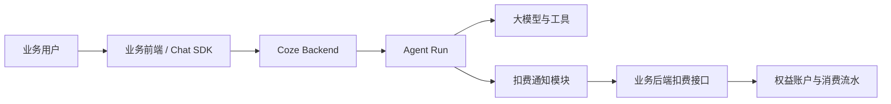
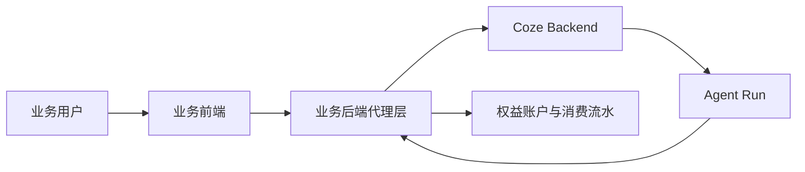
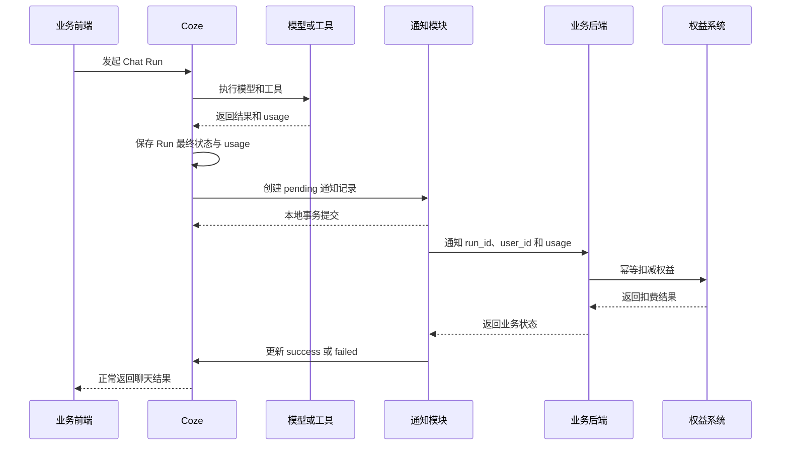
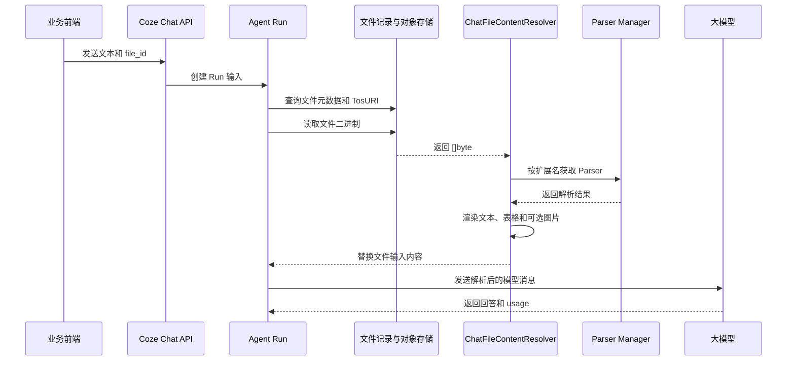

# Coze Run 用量扣费技术方案

> 状态：方案定稿，等待业务后端提供并确认扣费接口
>
> 记录日期：2026-09-20
>
> 方案性质：当前版本的过渡扣费方案

## 1. 文档概述

### 1.1 文档目的

本文将 Coze Run 用量扣费的已确认结论整理为可实施的技术方案，明确系统职责、扣费触发条件、数据模型、接口契约、事务边界和异常处理方式，作为后续开发和联调依据。

### 1.2 适用范围

本文适用于当前业务前端直接接入 Coze Chat SDK、由 Coze 执行 Agent Run 并在 Run 结束后通知业务后端扣费的场景。

本文覆盖：

- 单次 Run 的实际 Token usage 采集和扣费通知。
- 业务用户与业务权益账户的定位。
- 扣费通知结果的本地持久化。
- 通知接口的幂等、事务和异常处理。
- 后续切换到业务后端代理模式时需要保留的边界。

本文不定义业务后端内部的余额模型、权益定价规则和消费统计模型。

### 1.3 方案状态与版本

本方案基于《Coze Run 用量扣费通知过渡方案》整理。当前方案已经确认，开发启动前仍需等待业务后端提供最终接口契约。

### 1.4 参考文档

- [Coze Run 用量扣费通知过渡方案](./coze-run-usage-billing-notification-design.md)
- [业务系统集成 Coze 的账号、对话与计费设计记录](./business-system-integration-and-billing-design.md)
- [Coze 对话用量与 OpenAPI 现状参考](./coze-usage-data-and-openapi-reference.md)

## 2. 背景与问题

当前业务前端直接接入 Coze Chat SDK。每轮对话都会在 Coze 中创建一条 Run 记录，并在执行结束时保存该轮实际产生的 Token 用量。

业务系统需要根据每轮真实消耗扣减用户或租户权益，但业务后端的 Coze 接口代理尚未完成。因此当前版本由 Coze 在 Run 完成后主动调用业务后端的扣费接口，将 Run 的身份、最终状态和 usage 通知给业务系统。

该方案需要同时解决以下问题：

1. 在 Coze 侧正确判断 Run 是否已经真正结束。
2. 对完成、失败和取消的 Run 按实际 usage 决定是否扣费。
3. 确保同一个 Run 不会被重复扣费。
4. 扣费接口异常时不影响已经完成的聊天结果。
5. 保留足够的通知记录，支持人工查账和后续对账。
6. 保持扣费通知模块独立，未来可以在业务后端代理上线后移除。

## 3. 方案目标与非目标

### 3.1 方案目标

- 将单次 Run 的最终实际 usage 通知给业务后端。
- 由业务后端根据业务用户标识定位用户、租户和权益账户。
- 由业务后端完成最终扣费和消费流水记录。
- 使用 `run_id` 保证业务扣费幂等。
- 在 Coze 侧保存通知结果，支持失败排查和人工对账。
- 将扣费失败与聊天主流程解耦。
- 为未来业务后端代理 Coze 请求预留清晰的替换边界。

### 3.2 非目标

本版本不实现以下能力：

- Coze 内部维护余额、套餐或权益规则。
- Coze 内部维护按用户、租户或时间段汇总的用量统计表。
- Token 预扣、余额冻结、退款或严格的实时余额控制。
- 扣费通知失败的自动重试和定时补偿任务。
- 消息队列、Outbox Worker 或独立账务服务。
- MCP、embedding、rerank、图片生成等非 LLM 资源的独立计费模型。
- 业务后端代理层的完整实现。

### 3.3 当前版本的范围边界

Coze 只负责提供事实用量和通知结果，业务系统负责最终账务。任何余额校验、权益扣减、定价换算和消费流水写入都必须在业务后端完成。

## 4. 总体方案

### 4.1 当前版本架构



当前流程为：

1. 业务前端携带业务用户标识调用 Coze。
2. Coze 执行 Agent、模型和工具调用。
3. Coze 保存 Run 的最终状态和 usage。
4. Coze 在存在实际 usage 时创建扣费通知记录。
5. Coze 提交本地事务后调用业务后端扣费接口。
6. 业务后端按 `run_id` 幂等扣减权益并返回处理结果。
7. Coze 更新通知记录状态，但不改变已经产生的聊天结果。

### 4.2 长期目标架构



长期由业务后端代理 Coze 请求和响应，在可信登录态中取得用户身份，并在业务系统内完成用量结算。届时 Coze 的主动通知模块可以关闭并移除。

### 4.3 核心设计原则

1. **实际 usage 优先**：扣费依据 Run 最终保存的实际 usage，不根据用户是否看到回答推断成本。
2. **业务账务归属业务系统**：Coze 不维护余额，不成为最终账务事实来源。
3. **一次 Run 一次结算**：使用 `run_id` 作为跨系统幂等键。
4. **扣费与聊天解耦**：通知失败不能把已完成的聊天改成失败。
5. **通知模块可移除**：不向核心 Run、Conversation 和 Message 表增加业务扣费字段。
6. **本地先落库、对外后调用**：先提交 Run 和通知记录，再调用业务后端，避免外部调用发生在未提交事务中。

### 4.4 当前方案与长期方案的关系

当前方案是过渡实现，不改变长期职责划分：业务系统仍然是用户、租户、权益余额和消费流水的事实来源，Coze 仍然是 Agent 执行和 usage 采集引擎。

## 5. 系统职责划分

### 5.1 Coze 职责

- 执行 Agent、模型和工具调用。
- 保存 Run 的最终状态和实际 usage。
- 在统一 Run 收尾入口判断是否需要发送扣费通知。
- 创建和更新扣费通知结果记录。
- 调用业务后端扣费接口。
- 记录 HTTP 状态、业务状态、响应摘要和错误信息。
- 保证通知异常不会改变聊天主流程结果。

### 5.2 业务后端职责

- 根据 `user_id` 定位业务用户、所属租户和权益账户。
- 校验请求字段和 usage 合法性。
- 以 `run_id` 建立唯一约束并实现幂等处理。
- 写入消费流水并扣减余额或权益。
- 返回明确的业务成功、重复处理或失败状态。
- 承担后续用户、租户和时间范围的用量统计。

### 5.3 业务前端职责

- 通过 Chat SDK 发起对话。
- 传递业务系统生成的用户标识。
- 不持有业务后端扣费接口的服务凭据。
- 不直接调用扣费接口，也不根据前端提交的余额信息做权限判断。

### 5.4 明确不属于 Coze 的职责

Coze 不负责：

- 解析或决定业务套餐价格。
- 判断业务用户是否有足够余额。
- 维护业务租户权益。
- 处理业务退款和账务冲正。
- 统计最终业务收入或账单金额。

## 6. 用户身份与扣费标识

### 6.1 用户身份传递

当前业务前端向 Chat SDK 传递的用户信息示例：

```json
{
  "id": "tenantId:userId",
  "nickname": "用户显示名称",
  "url": ""
}
```

Chat SDK 发起请求时，Coze 主要接收其中的 `id` 作为 `user_id`，并将其保存到 Run 记录中。昵称和头像只用于前端展示，不是扣费依据。

### 6.2 `user_id` 的组成与可信边界

当前可以继续使用 `tenantId:userId` 作为业务用户标识，也可以在接口确定时改为全局唯一的业务用户 ID。无论采用哪种格式，都必须满足：

- 能唯一定位业务用户。
- 能由业务后端解析或查询所属租户和权益账户。
- 不依赖昵称、头像等可变信息。
- 不把浏览器提交的租户或用户字段直接当作授权依据。

当前过渡方案中，`user_id` 是 Coze 到业务后端的定位信息，不是 Coze API Token，也不能单独替代接口认证。

### 6.3 `run_id`、`chat_id` 与 `conversation_id`

| 标识 | 含义 | 扣费用途 |
| --- | --- | --- |
| `run_id` | Coze 内部一次 Agent Run 的唯一标识 | 业务扣费幂等键 |
| `chat_id` | OpenAPI 对外暴露的单次 Chat Run 标识 | 通常与 `run_id` 对应，具体以 Run 记录为准 |
| `conversation_id` | 多轮对话标识 | 审计、排查和会话归属，不作为扣费幂等键 |
| `user_id` | 外部业务用户标识 | 定位用户和租户 |

一个 `conversation_id` 可以包含多个 Run，因此不能以会话结束作为扣费时机。

### 6.4 租户、用户与权益账户的映射

业务后端收到 `user_id` 后负责完成以下映射：

```text
user_id
  -> 业务用户
  -> 所属租户
  -> 权益账户
  -> 消费流水
```

Coze 不复制这套映射关系，也不在通知表中保存业务余额快照。

## 7. 扣费触发规则

### 7.1 扣费判断原则

核心规则如下：

```text
有实际 usage 就通知扣费，没有实际 usage 就不通知扣费。
```

判断依据是 Run 最终保存的实际用量，而不是单独依据 Run 状态。

### 7.2 Run 状态与扣费关系

| Run 最终状态 | 有实际 usage | 是否创建扣费通知 |
| --- | --- | --- |
| `completed` | 是 | 是 |
| `completed` | 否 | 否 |
| `failed` | 是 | 是 |
| `failed` | 否 | 否 |
| `cancelled` | 是 | 是 |
| `cancelled` | 否 | 否 |

失败和取消不代表没有成本。只要模型或其他已纳入本方案的计费用量已经产生，就必须通知业务后端结算。

### 7.3 usage 字段定义

建议通知接口使用统一的 Token 字段：

| 字段 | 含义 |
| --- | --- |
| `input_tokens` | 输入 Token 数 |
| `output_tokens` | 输出 Token 数 |
| `total_tokens` | 输入和输出 Token 总数 |

这些字段应来自 Run 最终保存的 usage。Prompt Token 可能包含系统提示词、历史消息、工具定义、检索结果和工具循环中的模型调用，不等于当前用户消息的 Token 数。

MCP、embedding、rerank、图片生成等非 LLM 资源不应默认视为已经包含在 `total_tokens` 中，除非业务接口另有明确约定。

### 7.4 无 usage 时的处理

如果 Run 最终没有可用 usage，Coze 不创建扣费通知，也不尝试根据文本长度、运行时长或状态推算 Token 消耗。

对于模型中断且供应商未返回 usage 的情况，当前版本接受无法估算已产生消耗的限制。

### 7.5 不做预扣

当前版本不在 Run 开始前预扣 Token，不实现余额冻结和退款。业务后端只在收到 Run 最终 usage 后进行后结算。

## 8. Run 最终收尾与用量获取

### 8.1 Run 真正结束的定义

用户点击取消只代表收到取消请求，不等于 Run 已经完成结算。扣费通知必须发生在以下条件之后：

```text
Run 开始
    -> 创建 Run 记录
    -> 模型和工具执行
    -> 执行真正退出
    -> 确定最终状态和最终 usage
    -> 保存 Run 最终记录
    -> 创建扣费通知记录
```

### 8.2 最终状态确认

`completed`、`failed` 和 `cancelled` 都应进入统一的最终收尾路径。收尾路径负责：

1. 读取最终状态。
2. 读取最终 usage。
3. 判断是否存在可结算用量。
4. 在需要时创建唯一的 `pending` 通知记录。

同一个 Run 不应在多个终态入口分别生成通知，避免完成、取消和异常处理路径重复扣费。

### 8.3 usage 的来源

当前以 Run 最终保存的 usage 作为通知来源。流式响应中的消息扩展字段仅适合实时展示和调试，不能替代最终 Run usage。

一个 Run 内包含多次模型调用时，应以 Run 收尾时保存的累计结果为准。对于当前代码无法确认是否完整累加的执行路径，需要在实现和联调阶段单独核对。

### 8.4 统一收尾入口

扣费通知应挂在能够同时覆盖以下终态的统一收尾边界：

- 正常完成。
- 执行失败。
- 用户取消。

通知模块不应散落在各个模型、工具或消息事件处理器中，也不应依赖前端是否收到某个流式事件。

### 8.5 防止重复触发

本地通知表以 `run_id` 建立唯一约束。统一收尾入口即使因重入、进程恢复或重复事件再次执行，也只能获取已有通知记录，不能创建第二条记录。

## 9. 端到端处理流程

### 9.1 正常完成流程



### 9.2 失败流程

如果 Run 失败但已经产生 usage，仍按实际 usage 创建通知并调用业务后端。业务后端是否按照失败状态使用不同的计价规则，由业务后端负责，本方案只传递最终状态和 usage。

如果 Run 失败且没有 usage，则不创建通知。

### 9.3 取消流程

取消请求到达后，必须等待执行真正退出并确定最终 usage。取消后存在 usage 时照常通知扣费；没有 usage 时不扣费。

### 9.4 通知处理状态流转

```text
无通知记录
    -> pending：Run 已落库且存在 usage
    -> success：业务后端明确表示扣费成功或已处理
    -> failed：调用失败、响应失败或业务明确拒绝
```

当前版本不自动把 `failed` 转回 `pending`，也不由 Coze 自动发起重试。

## 10. 扣费通知结果表设计

### 10.1 数据表职责

通知结果表不是业务账本，也不是用量汇总表。它只记录：

```text
某个 Run 是否通知过业务扣费接口，以及最后一次通知结果是什么。
```

该表应独立于核心 Run、Conversation 和 Message 表，便于未来整体删除通知模块。

### 10.2 字段设计

最终字段名应遵循仓库现有命名规范，建议至少包含：

| 字段 | 含义 |
| --- | --- |
| `run_id` | Run 唯一标识，唯一键和业务幂等键 |
| `user_id` | 外部业务用户标识 |
| `conversation_id` | 所属多轮会话 |
| `run_status` | Run 最终状态 |
| `input_tokens` | 输入 Token |
| `output_tokens` | 输出 Token |
| `total_tokens` | 总 Token |
| `notification_status` | `pending`、`success` 或 `failed` |
| `http_status` | 业务接口返回的 HTTP 状态码 |
| `business_code` | HTTP 200 响应中的业务状态码 |
| `response_body` | 必要时保存精简后的响应内容 |
| `error_message` | 网络、超时、解析或业务错误摘要 |
| `created_at` | 通知记录创建时间 |
| `updated_at` | 最后更新时间 |

### 10.3 状态定义

- `pending`：Run 已经完成本地落库，通知记录已经创建，但业务接口尚未得到最终结果。
- `success`：业务接口明确返回扣费成功，或明确返回该 `run_id` 已经处理。
- `failed`：HTTP、网络、响应解析或业务状态表明扣费没有成功。

### 10.4 唯一约束与索引

必须为 `run_id` 建立唯一约束。为了支持排查，建议根据实际查询需求为以下字段建立索引：

- `notification_status`。
- `created_at`。
- `updated_at`。
- `user_id` 或 `conversation_id`。

是否建立额外索引应结合通知表数据量和现有数据库规范决定。

### 10.5 数据保留策略

当前方案要求通知记录能够支持人工查账和过渡期对账，因此不能与 Run 记录同步立即删除。具体保留期限由业务系统的审计和数据保留策略确定。

## 11. 业务扣费接口设计

### 11.1 接口职责

业务扣费接口接收一次 Run 的最终结算信息，由业务后端完成：

1. 校验用户和租户是否存在。
2. 定位权益账户。
3. 按业务规则换算和扣减权益。
4. 以 `run_id` 写入消费流水。
5. 返回明确的处理结果。

### 11.2 建议请求参数

```json
{
  "run_id": "123456",
  "conversation_id": "789012",
  "user_id": "100:200",
  "run_status": "completed",
  "usage": {
    "input_tokens": 100,
    "output_tokens": 50,
    "total_tokens": 150
  }
}
```

字段约定：

| 字段 | 要求 |
| --- | --- |
| `run_id` | 必填，业务幂等键 |
| `conversation_id` | 用于审计和问题排查 |
| `user_id` | 用于定位业务用户和租户 |
| `run_status` | `completed`、`failed` 或 `cancelled` |
| `usage` | Run 最终实际用量 |

最终 URL、HTTP 方法、字段类型和认证方式以业务后端正式接口契约为准。

### 11.3 响应结构

业务后端需要提供可机器判断的响应，至少应能区分：

- 本次扣费成功。
- 该 `run_id` 已经处理过，当前请求无需重复扣费。
- 用户、租户、权益账户或 usage 非法。
- 余额或业务规则拒绝扣费。
- 系统暂时不可用，需要人工排查。

具体业务码和响应字段等待业务后端确认。

### 11.4 成功与失败判断

Coze 不仅根据 HTTP 状态判断成功：

1. HTTP 状态不是 `200`：记录为 `failed`。
2. HTTP 状态为 `200`：继续解析业务响应码。
3. 业务码明确表示扣费成功或已处理：记录为 `success`。
4. 业务码表示拒绝、参数错误或其他失败：记录为 `failed`。
5. 响应无法解析或缺少必要字段：记录为 `failed`。

### 11.5 HTTP 超时与错误处理

调用方必须设置明确的请求超时时间。超时、连接失败、TLS 错误和响应解析错误都只更新通知结果，不改变聊天结果。

由于当前版本不自动重试，失败记录必须保存足够的错误摘要，便于后续人工处理或后续补偿机制接入。

### 11.6 接口幂等要求

业务后端必须以 `run_id` 建立唯一约束，并实现以下语义：

```text
第一次收到 run_id：写消费流水并扣减余额
再次收到相同 run_id：不重复扣费，返回已处理结果
```

业务后端不能依赖 Coze 只调用一次来保证账务正确。

## 12. 事务一致性与幂等设计

### 12.1 Run 落库与通知记录创建

Run 最终状态更新和 `pending` 通知记录创建建议放在同一个本地数据库事务中：

```text
确定最终状态和 usage
    -> 更新 Run 最终记录
    -> 判断 usage 是否存在
    -> 创建唯一的 pending 通知记录
    -> 提交本地事务
    -> 调用业务后端
```

没有 usage 时不创建通知记录，但 Run 最终状态仍正常保存。

### 12.2 `run_id` 幂等

Coze 侧通过通知表唯一约束避免同一个 Run 创建多条通知记录。业务后端侧通过消费流水唯一约束避免同一个 Run 重复扣费。两侧都必须实现幂等，不能只依赖其中一侧。

### 12.3 本地事务边界

对外 HTTP 调用必须发生在本地事务提交之后。不能在事务持有期间等待业务后端响应，否则会延长数据库锁持有时间，并使外部调用和本地回滚产生难以处理的状态组合。

### 12.4 对外调用时机

通知记录成功提交后立即发起同步 HTTP 调用即可满足当前过渡方案。调用失败时将结果写回 `failed`，不阻塞前端流式结束事件。

### 12.5 重复请求处理

重复触发可能来自：

- 统一收尾入口被重复执行。
- 进程在通知前或通知后异常退出。
- 后续人工或补偿逻辑再次发起通知。

所有这些情况都必须通过 `run_id` 的本地唯一约束和业务幂等语义保证不会重复产生消费流水。

## 13. 异常处理与对账

### 13.1 业务接口调用失败

业务接口返回非成功 HTTP 状态、网络错误或业务失败码时：

1. 保留 `pending` 记录中的 Run 和 usage 信息。
2. 更新通知状态为 `failed`。
3. 保存 HTTP 状态、业务码和错误摘要。
4. 保持聊天已经产生的最终结果不变。

### 13.2 进程异常退出

当前版本接受以下窗口：

- Run 已保存，但通知记录尚未创建。
- `pending` 通知记录已创建，但业务接口尚未调用。
- 业务接口已处理，但 Coze 尚未将通知记录更新为 `success`。

业务后端的 `run_id` 幂等是最后一道账务保护。`pending` 和 `failed` 记录需要通过查账发现，不由当前版本自动补偿。

### 13.3 业务响应无法解析

HTTP 200 但响应体格式错误、业务码缺失或字段类型不符合契约时，视为失败处理，不得将其记录为成功。

### 13.4 `pending` 状态处理

`pending` 表示本地通知已经创建，但没有得到业务接口的最终结果。当前版本不自动重试，运维或业务人员可以根据 `run_id`、用户和 usage 信息进行人工核对。

### 13.5 `failed` 状态处理

`failed` 表示本次通知没有确认扣费成功，不代表聊天失败，也不代表业务账务已经完成。人工处理时必须先查询业务后端是否已经按 `run_id` 成功入账，再决定是否需要补偿，避免重复扣费。

### 13.6 人工排查与对账信息

通知记录至少要能关联以下信息：

- `run_id`。
- `conversation_id`。
- `user_id`。
- Run 最终状态。
- 三类 Token usage。
- 通知状态。
- HTTP 状态和业务码。
- 创建和更新时间。
- 错误信息或响应摘要。

### 13.7 当前版本不提供的自动补偿能力

当前版本明确不实现：

- 失败通知自动重试。
- 定时扫描 `pending` 的补偿任务。
- 消息队列投递和消费确认。
- 自动对账和差异修复。

这些能力可以在业务后端代理尚未上线且失败量需要自动处理时单独设计。

## 14. 安全与配置

### 14.1 用户身份可信边界

当前前端直连 Coze 的过渡形态不能把浏览器提交的 `user_id` 视为完整的安全认证边界。扣费接口必须具备服务间访问控制，并在业务后端重新校验用户、租户和权益账户。

长期方案中，业务后端代理 Coze 请求，浏览器只携带业务系统登录态，Coze PAT 不暴露给浏览器。

### 14.2 内部接口访问限制

当前方案暂不强制增加签名、服务 Token 或 mTLS，但扣费接口至少应限制网络来源，并保留后续增加服务认证的配置扩展点。

接口上线前需要由双方确认：

- 允许访问的网络范围。
- 服务身份识别方式。
- 请求超时时间。
- 错误响应是否包含敏感信息。

### 14.3 敏感信息处理

日志和通知表中的 `response_body`、`error_message` 只能保存排查所需的最小信息，不应写入 PAT、完整 Authorization 头、用户隐私内容或模型上下文。

### 14.4 配置项

建议至少提供以下配置：

| 配置项 | 作用 |
| --- | --- |
| 扣费通知开关 | 整体启用或关闭主动通知 |
| 业务接口 URL | 指定扣费接口地址 |
| 请求超时时间 | 控制单次 HTTP 调用最长等待时间 |
| 最大响应体保存长度 | 防止异常响应撑大数据库字段 |
| 连接和空闲超时 | 控制 HTTP 客户端连接行为 |

关闭主动通知只应停止扣费接口调用和相关写入，不应影响 Run、Conversation、Message 和 usage 的正常持久化。

### 14.5 不影响聊天主流程

扣费通知属于 Run 结束后的旁路处理：

- 业务接口慢或不可用不能阻塞正常流式结束事件。
- 扣费接口返回失败不能把聊天状态改为失败。
- 通知模块异常不能覆盖 Run 的最终状态和 usage。

## 15. 可观测性与运维

### 15.1 日志

关键日志应包含但不泄露敏感内容：

- `run_id`。
- `conversation_id`。
- `user_id` 的脱敏值或内部关联 ID。
- Run 最终状态。
- `total_tokens`。
- 通知状态变化。
- HTTP 状态、业务码和耗时。

错误日志需要区分网络错误、HTTP 错误、业务失败和响应解析失败。

### 15.2 指标

建议记录以下指标：

- 通知创建数量。
- `success`、`failed` 和 `pending` 数量。
- 业务接口调用耗时。
- HTTP 错误数量。
- 响应解析错误数量。
- 按 Run 状态划分的通知数量。

### 15.3 告警

当前版本虽然不自动补偿，但仍应对以下情况提供运维可见性：

- `failed` 数量持续增加。
- `pending` 长时间未变化。
- 业务接口超时率升高。
- 通知表写入失败。
- 业务后端返回未知业务码。

### 15.4 排查信息

排查时应优先使用 `run_id` 串联：

```text
RunRecord
  -> 扣费通知记录
  -> 业务后端请求日志
  -> 业务消费流水
```

`conversation_id` 和 `user_id` 用于辅助确认会话和用户归属，不能替代 `run_id` 的幂等作用。

### 15.5 通知记录查询

后台查询能力至少应支持按以下条件筛选：

- `run_id`。
- `user_id`。
- `conversation_id`。
- 通知状态。
- Run 状态。
- 创建时间范围。

## 16. 开发实现边界

### 16.1 模块划分

建议将实现拆分为以下边界：

1. **Run 收尾适配层**：读取最终状态和 usage，决定是否触发通知。
2. **通知结果数据访问层**：创建、查询和更新通知记录。
3. **扣费通知客户端**：封装业务后端 HTTP 请求、超时和响应解析。
4. **通知状态处理层**：将调用结果映射为 `pending`、`success` 或 `failed`。
5. **配置层**：管理开关、URL、超时和响应保存限制。

余额、权益、计价和消费流水逻辑不应进入上述 Coze 模块。

### 16.2 数据库迁移

数据库迁移只新增独立的扣费通知结果表及其索引，不修改核心 Run 表增加业务扣费字段。

表结构应支持：

- `run_id` 唯一约束。
- usage 三个数值字段。
- 通知状态。
- HTTP 和业务响应信息。
- 创建和更新时间。

### 16.3 Run 收尾入口改造

实现时应找到同时覆盖 `completed`、`failed` 和 `cancelled` 的统一收尾边界，将通知触发放在 Run 最终状态和 usage 持久化之后，并保证通知记录创建与 Run 更新处于同一事务。

### 16.4 通知客户端封装

通知客户端应独立封装：

- 请求组装。
- HTTP 客户端配置。
- 超时处理。
- 响应体大小限制。
- 业务码解析。
- 错误分类。

核心执行代码只能依赖通用的“最终 usage 通知”边界，不应直接依赖业务余额、租户或计价规则。

### 16.5 配置开关

应支持通过配置整体关闭主动通知。关闭后不应影响原有 Run 执行、状态落库、消息保存和 usage 持久化。

### 16.6 不修改的核心领域逻辑

本方案不将业务扣费逻辑写入以下核心对象：

- Conversation。
- Message。
- RunRecord 的业务字段。
- Agent、Workflow 或模型适配器。

扣费通知只依赖 Run 收尾时已经存在的通用状态和 usage。

## 17. 聊天附件下载、解析与模型输入

### 17.1 设计目标

当前聊天附件上传后只保存为文件对象并传递 `file_id` 或文件 URL，通用 Agent Run 不会自动读取 `.docx`、`.pdf`、`.xlsx` 等文档内容。为支持清源广告法场景下的附件总结和问答，本方案增加一条 Coze 内部的文件内容预处理链路：

```text
聊天附件
    -> 查询文件记录
    -> 从 Coze 对象存储读取二进制
    -> Parser Manager 解析
    -> 渲染为文本、表格或图片消息
    -> 注入 Agent 输入
    -> 调用大模型
```

该链路不依赖外部 fetch、浏览器、MCP 或第三方工具，也不改变知识库的索引和检索流程。

### 17.2 处理原则

1. **只处理带附件的 Run**：没有文件附件时，现有文本、图片、音频、视频和历史消息路径保持不变。
2. **原始文件不落本地目录**：通过 Storage 读取对象存储内容，在内存和解析器管道中完成处理。
3. **模型默认接收解析结果**：文档类附件转换为文本和表格内容，不直接把原始二进制交给通用模型调用链。
4. **解析器与知识库业务解耦**：复用 Parser Manager 和各格式 Parser，不创建临时 Knowledge、Document、Slice 或搜索索引。
5. **解析失败显式返回**：不能继续把不可读的 URL 静默传给模型并让模型自行猜测。
6. **处理过程受资源限制**：文件大小、附件数量、解析耗时、并发数和模型上下文长度都必须有限制。
7. **默认不持久化正文**：解析后的文本只用于当前 Run，除非后续明确增加审计或缓存需求。

### 17.3 解析流程



### 17.4 解析结果与模型输入

解析过程存在三个不同层次的结果：

```text
原始文件二进制
    -> []*schema.Document：Parser 输出
    -> []*schema.ChatMessagePart：模型输入
```

#### 17.4.1 原始文件

原始文件存放在 Coze 配置的对象存储中。当前 Storage 接口通过 `GetObject` 返回 `[]byte`，解析调用方使用 `bytes.NewReader` 将内容交给 Parser。

#### 17.4.2 Parser 输出

现有 Parser 输出为 `[]*schema.Document`：

- 正文：`Document.Content` 中的文本块。
- 表格：转换为带有表格边界的文本表示，当前 Parser Manager 使用 `<table>`、`<tr>` 和 `<td>` 结构。
- 图片：可选地写入对象存储，并在 `Document.Content` 中保留图片引用和可选 OCR 文本。

具体实现可复用：

- `backend/infra/document/parser` 的 Parser Manager 接口。
- `backend/infra/document/parser/impl/builtin/parse_docx.py`。
- `backend/infra/document/parser/impl/builtin/py_parser_protocol.go`。

#### 17.4.3 模型输入

第一版模型输入建议如下：

| 输入内容 | 模型表示 |
| --- | --- |
| 正文、标题、列表 | 文本或 Markdown 文本 |
| 简单表格 | Markdown 表格 |
| 复杂表格 | `<table>` 类结构化文本 |
| 文档内图片 | 第一版默认关闭；后续可使用图片消息或 OCR 文本 |

不建议把 Parser 的内部 JSON、缓存文件内容或原始 `.docx` 二进制直接放入 Prompt。

### 17.5 存储和临时文件策略

当前版本不创建本地临时文件：

```text
file_id
    -> 文件记录中的 TosURI
    -> Storage.GetObject
    -> 内存中的 []byte
    -> bytes.NewReader
    -> Parser
```

`.docx` 的 Python Parser 通过标准输入接收二进制数据，不需要落盘。启用图片提取时，提取出的图片可能写回 Coze 对象存储，用于后续图片引用；这不是本地临时目录。

当前 `Storage.GetObject` 会将完整对象读入内存，因此必须配合最大文件大小限制。后续如果需要支持更大文件，可扩展 Storage 的流式读取接口，但不作为第一版前提。

### 17.6 与知识库链路的关系

本方案复用知识库的底层解析能力，但不复用知识库的完整业务流程。

复用范围：

- Parser Manager。
- DOCX、PDF、TXT、Markdown、CSV、XLSX 等格式 Parser。
- OCR 和对象存储能力。

不复用范围：

- Knowledge、Document、Slice 记录创建。
- 知识库异步索引事件。
- 向量化、关键词索引和搜索引擎写入。
- TopK 检索和 RAG 拼装。
- 临时知识库数据清理。

文件总结和单次附件问答需要完整上下文或受控截断，不应为了复用知识库而强制走 TopK 检索。

### 17.7 Agent 集成边界

新增独立的 `ChatFileContentResolver`，职责包括：

1. 根据 `file_id` 查询文件元数据。
2. 校验文件归属、文件状态、扩展名和大小。
3. 通过 Storage 读取原始二进制。
4. 根据文件扩展名构造 Parser 配置并执行解析。
5. 将解析结果渲染为模型输入消息。
6. 返回解析失败、超限或不支持格式的明确错误。

Resolver 只自动解析当前输入中的文件附件。历史消息中的文件只转换为文件名和 `file_key` 元信息，不自动下载或解析；模型需要历史文件内容时，必须显式调用 `file_search` 或 `file_download`。普通文本、图片、音频和视频消息不应经过文档解析逻辑。

当前 Agent Runner 将不支持的 `FileURL` 降级为 URL 文本。接入 Resolver 后，文件输入应在该降级逻辑之前完成解析；未启用开关或解析失败时，按照配置决定是否保留旧行为或直接返回文件处理错误。

### 17.8 失败和回滚语义

- 未启用文件解析：保持现有行为，不改变其他 Run。
- 文件格式不支持：返回明确的“不支持文件类型”错误。
- 文件超过大小限制：返回明确的“文件过大”错误。
- 对象存储读取失败：Run 不进入模型调用，记录可排查错误。
- Parser 超时或异常：Run 不把 URL 当作正文继续发送，记录解析失败。
- 模型上下文超过限制：按照最大内容配置截断或返回明确错误。

通过关闭文件解析总开关，可以快速回滚新增路径，不需要数据库回滚或删除已有数据。

### 17.9 对现有功能的隔离保证

实现必须满足以下约束：

- 不修改 Conversation、Message 和 RunRecord 的既有字段和持久化语义。
- 不修改知识库索引、检索和分片逻辑。
- 不改变无附件 Run 的输入和输出。
- 不改变图片、音频、视频能力判断。
- 不改变 Workflow 工具和 MCP 工具执行逻辑。
- 不在日志中输出文件正文、二进制内容或敏感签名 URL。
- 文件解析失败不能影响没有附件的其他 Run。

### 17.10 配置和环境变量

以下是建议提升为环境变量或统一配置的参数。名称仅作为设计建议，最终应遵循项目配置规范。

#### 17.10.1 必需开关

| 建议配置名 | 类型 | 建议初始值 | 作用 |
| --- | --- | --- | --- |
| `COZE_CHAT_FILE_PARSE_ENABLED` | bool | `false` | 是否启用聊天附件解析；灰度验证完成后再改为 `true` |

#### 17.10.2 资源保护参数

| 建议配置名 | 类型 | 建议初始值 | 作用 |
| --- | --- | --- | --- |
| `COZE_CHAT_FILE_PARSE_MAX_FILE_SIZE_BYTES` | int64 | `10485760` | 单个文件最大读取大小，建议从 10 MiB 开始 |
| `COZE_CHAT_FILE_PARSE_MAX_FILES_PER_RUN` | int | `5` | 单次 Run 最大解析附件数量 |
| `COZE_CHAT_FILE_PARSE_TIMEOUT_SECONDS` | int | `30` | 单个文件解析超时时间 |
| `COZE_CHAT_FILE_PARSE_MAX_CONCURRENT` | int | `2` | 单实例同时执行的最大文件解析数 |
| `COZE_CHAT_FILE_PARSE_MAX_CONTENT_CHARS` | int | `80000` | 单个文件注入模型前允许保留的最大字符数 |
| `COZE_CHAT_FILE_PARSE_MAX_TOTAL_CONTENT_CHARS` | int | `120000` | 单次 Run 所有附件合并后的最大字符数 |

#### 17.10.3 解析策略参数

| 建议配置名 | 类型 | 建议初始值 | 作用 |
| --- | --- | --- | --- |
| `COZE_CHAT_FILE_PARSE_ALLOWED_EXTENSIONS` | string list | `docx,pdf,txt,md,csv,xlsx` | 允许进入聊天解析链路的扩展名 |
| `COZE_CHAT_FILE_PARSE_EXTRACT_TABLES` | bool | `true` | 是否提取文档中的表格 |
| `COZE_CHAT_FILE_PARSE_EXTRACT_IMAGES` | bool | `false` | 是否提取文档中的嵌入图片 |
| `COZE_CHAT_FILE_PARSE_IMAGE_OCR` | bool | `false` | 提取图片时是否执行 OCR，依赖 OCR 服务配置 |
| `COZE_CHAT_FILE_PARSE_ON_ERROR` | enum | `error` | 解析失败时返回错误，禁止静默把 URL 当正文 |

建议将安全阈值和总开关配置化，将稳定的文件格式映射和模型渲染规则保留在代码中，避免通过环境变量动态改变数据结构。

### 17.11 对扣费的影响

解析后的正文会作为模型输入，因此会影响 Run 的输入 Token usage：

- Parser 本身的 CPU、内存和 OCR 消耗不自动计入 LLM Token usage。
- 注入模型的文本会计入本轮输入 Token。
- 文件越大、上下文越长，单轮扣费越高。
- 现有 Run usage 和扣费通知机制无需增加新的扣费字段。

为了避免文件解析造成不可控的单轮账单，必须启用单文件和单 Run 内容上限。

### 17.12 全局 `file_search` 工具

为支持模型主动查询历史附件，Agent 工具列表增加平台内置的 `file_search` 工具。该工具与 Skill、Plugin、MCP 和 Workflow 工具平级，不依赖外部 MCP 或用户自定义 Skill。

工具输入建议为：

```json
{
  "file_key": "优先使用的文件 URI / file_key",
  "file_name": "兼容用文件名",
  "query": "需要从附件中查找的问题"
}
```

工具执行流程：

```text
模型调用 file_search
    -> 后端根据 conversation_id、agent_id、user_id 收集当前会话文件引用
    -> 优先根据 file_key 精确定位；未提供时按 file_name 筛选，重复文件名选择最新附件；两者为空时搜索当前会话全部附件
    -> 查询解析缓存
    -> 缓存命中：直接返回解析内容
    -> 缓存未命中：下载、解析并写入缓存
    -> 返回带文件标识的文本结果
```

安全边界：

- 模型不能直接传入任意 MinIO URL 读取文件。
- `file_key` 只能精确匹配当前会话已经出现的文件 URI；`file_name` 只能匹配当前会话已经出现的文件名，重复文件名按最新附件处理。
- 后端通过当前会话和用户身份校验文件范围。
- 文件下载、解析、大小限制和缓存写入全部由后端完成。
- 工具返回内容受单次结果字符数限制。

当前版本同时保留两条互补路径：

1. 当前消息包含文件时，Resolver 直接解析并注入模型上下文；单轮文件数量和总内容上限只统计当前消息。
2. 历史文件只向模型提供文件元信息；模型需要定点查询时，使用 `file_search` 按需读取，需要脚本原始二进制时使用 `file_download`。

`file_search` 的全局注入通过配置开关控制。启用后 Agent 会进入现有工具调用路径，因此要求所选模型支持 Function Calling。没有附件的 Agent 仍然不会执行文件读取，但工具可能出现在其工具列表中。

### 17.13 解析缓存

解析缓存不写入 `message.content` 或 `message.model_content`，也不替代原始文件元数据。缓存内容只保存可复用的解析文本，缓存键包含：

```text
文件 URI
对象版本信息（ETag，无法取得时为空）
Parser 版本
解析策略配置
```

建议缓存键格式：

```text
chat:file-parse:{sha256(uri + etag + parser_version + parse_config)}
```

缓存命中和失效规则：

- 同一 Run 内相同 URI 只解析一次。
- 多轮对话中相同 URI 优先复用缓存。
- 对象 ETag 或解析配置变化时使用新缓存键。
- 缓存只保存有限时间，过期后重新解析。
- 缓存失败不能影响原始文件存储和消息持久化。

第一版使用 Redis 作为解析缓存，不新增文件元数据表。后续如需跨会话文件管理、独立权限、审计和生命周期控制，再引入独立文件资源表。

新增建议配置：

| 建议配置名 | 类型 | 建议初始值 | 作用 |
| --- | --- | --- | --- |
| `COZE_CHAT_FILE_TOOL_ENABLED` | bool | `true` | 是否向 Agent 注入全局 `file_search` 工具 |
| `COZE_CHAT_FILE_PARSE_CACHE_ENABLED` | bool | `true` | 是否启用解析结果缓存 |
| `COZE_CHAT_FILE_PARSE_CACHE_TTL_SECONDS` | int | `3600` | 解析缓存有效期 |

## 18. 已知限制与风险

当前版本主动接受以下限制：

- 不做自动重试和定时补偿。
- 不使用消息队列或 Outbox Worker。
- 内网调用暂不增加签名、服务 Token 或 mTLS。
- Coze 进程在特定时间窗口异常退出时，可能出现未完成通知或长期 `pending`。
- 模型中断且供应商不返回 usage 时无法估算真实消耗。
- 不做 Token 预扣，无法完全避免并发请求造成的短时透支。
- 单次 Run 内多次模型调用的 usage 累加仍需结合实际执行路径核对。
- 非 LLM 资源消耗不纳入默认 Token 扣费口径。

这些限制不应通过修改聊天结果或伪造 usage 来规避，应通过后续补偿、代理和计费模型设计逐步解决。

## 19. 待确认事项

开发和联调前需要业务后端确认：

1. 扣费接口 URL 和 HTTP 方法。
2. 请求字段名称、数据类型和必填规则。
3. HTTP 200 响应结构。
4. 扣费成功的业务状态码。
5. `run_id` 已处理时的状态码和响应语义。
6. 用户不存在、余额不足和业务拒绝的错误码。
7. 服务间认证方式和网络访问范围。
8. 请求超时时间。
9. 是否按用户扣费还是按租户扣费。
10. `failed` 和 `cancelled` Run 的计价规则。
11. `workflow_tokens`、`workflow_cost` 或其他非 LLM usage 是否纳入结算。
12. 通知记录和业务消费流水的保留期限。

在上述接口契约确认前，可以完成数据库和模块边界设计，但不应锁定最终 HTTP 客户端字段和成功判断代码。

## 20. 附录

### 20.1 请求示例

```http
POST /internal/billing/coze/run-settlement
Content-Type: application/json
```

```json
{
  "run_id": "123456",
  "conversation_id": "789012",
  "user_id": "100:200",
  "run_status": "completed",
  "usage": {
    "input_tokens": 100,
    "output_tokens": 50,
    "total_tokens": 150
  }
}
```

以上 URL 仅为文档示例，最终接口地址以业务后端提供的正式契约为准。

### 20.2 状态枚举

Run 终态：

```text
completed
failed
cancelled
```

通知状态：

```text
pending
success
failed
```

### 20.3 相关源码和数据参考

- Run 最终状态和 usage 持久化：见 [Coze 对话用量与 OpenAPI 现状参考](./coze-usage-data-and-openapi-reference.md)。
- 当前过渡方案和通知表建议：见 [Coze Run 用量扣费通知过渡方案](./coze-run-usage-billing-notification-design.md)。
- 业务账号、租户和长期代理架构：见 [业务系统集成 Coze 的账号、对话与计费设计记录](./business-system-integration-and-billing-design.md)。

### 20.4 术语说明

| 术语 | 说明 |
| --- | --- |
| Run | Coze 执行一次 Agent 请求的运行记录 |
| usage | 一次 Run 的实际 Token 用量 |
| `run_id` | Run 的唯一标识和扣费幂等键 |
| `conversation_id` | 多轮对话的唯一标识 |
| `user_id` | Coze 记录的外部业务用户标识 |
| 后结算 | Run 结束并得到实际 usage 后再扣减权益 |
| 业务后端代理 | 由业务后端代理浏览器与 Coze 之间的请求和响应 |
